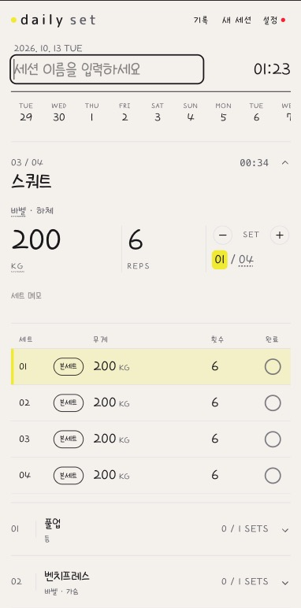

# Daily Set

세트 단위로 운동을 빠르게 기록하는 모바일 중심 웹앱(PWA)입니다.

[서비스 소개](https://daily.mingile.com/dailyset) · [앱 열기](https://daily.mingile.com/dailyset/app)



## 1. 프로젝트 소개

헬스장에서 세트마다 무게와 횟수를 남기는 사람을 위한 앱입니다. 로그인 없이 사용할 수 있으며, 운동 기록은 브라우저에 먼저 저장합니다. Notion을 연결하면 완료한 기록을 서버의 백그라운드 작업으로 전송하며, 전송에 실패한 기록은 다시 보낼 수 있습니다.

### 주요 기능

- **운동 기록**: 운동을 선택하고 세트별 무게·횟수·메모·기구를 기록합니다. 웜업과 본세트를 구분하고 kg/lb 입력을 지원합니다.
- **이전 기록 참고**: 이전 기록의 값을 새 운동에 채우고, 지난 세션의 세트를 함께 확인할 수 있습니다.
- **타이머**: 세션 전체와 현재 진행하는 운동의 경과 시간을 표시합니다.
- **저장과 복원**: 진행 중인 세션을 자동 저장하고, 새로고침 후에도 이어서 기록할 수 있습니다. 완료한 기록은 날짜별로 조회하고 세트 단위로 삭제할 수 있습니다.
- **Notion 연동**: 자신의 Notion 운동 목록을 사용하고, 완료한 기록을 보내거나 Notion에 저장된 기록을 가져올 수 있습니다.
- **PWA**: 홈 화면에 설치할 수 있으며, 캐시된 앱 화면에서 오프라인으로 운동을 기록할 수 있습니다.

### 주요 기술

| 기술                                          | 용도                                                     |
| --------------------------------------------- | -------------------------------------------------------- |
| Next.js 15 (App Router), React 19, TypeScript | 화면, 상태 관리, 서버 API                                |
| Tailwind CSS 4, shadcn/ui                     | 스타일링과 UI 컴포넌트                                   |
| TanStack Query                                | Notion 운동 목록 조회와 캐시                             |
| Notion API, MongoDB, Vercel Queue             | Notion 연동, 연결 정보·처리 결과 보관, 백그라운드 동기화 |
| Service Worker, Web App Manifest              | 오프라인 화면과 PWA 설치                                 |
| Vitest, Testing Library, Playwright           | 단위·컴포넌트·E2E 테스트                                 |
| GitHub Actions, Biome                         | CI 검사, 로컬 린트·포맷                                  |

## 2. 프로젝트 구조

주요 폴더와 진입점만 표시했습니다. 단위·컴포넌트 테스트는 검증 대상 코드 옆에, 브라우저 테스트는 `tests/`에 둡니다.

```text
.
├── .github/workflows/ci.yml     CI 검사
├── public/sw.js                서비스 워커
├── scripts/                    수동 벤치마크·성능 측정
├── src/
│   ├── app/
│   │   ├── page.tsx            랜딩 페이지
│   │   ├── app/page.tsx        앱 진입점
│   │   ├── RootClient.tsx      화면 전환·세션 상태·저장 조율
│   │   ├── api/                Notion 연결·조회·동기화 API
│   │   └── …                  운동 선택·세션 편집·기록·설정 화면
│   ├── components/            공용 UI와 랜딩·PWA 컴포넌트
│   ├── hooks/                 세션 편집·운동 목록 조회·시간 갱신
│   ├── lib/                   도메인 로직·로컬 저장·외부 연동
│   │   └── notion/            Notion 데이터 처리와 동기화 지원
│   ├── data/                  내장 운동 목록
│   └── test-utils/            공용 테스트 도구
└── tests/
    ├── e2e/                   주요 사용자 흐름
    ├── pwa/                   오프라인 동작·manifest
    └── helpers.ts             브라우저 테스트 공용 헬퍼
```

## 3. 테스트와 CI

### 테스트 범위와 실행

| 종류          | 도구                     | 주요 검증 대상                                                             | 실행 명령          |
| ------------- | ------------------------ | -------------------------------------------------------------------------- | ------------------ |
| 단위          | Vitest                   | 세션 편집 규칙, 타이머 계산, 저장 데이터 생성, 전송 대기열과 재시도 처리   | `npm run test:run` |
| 컴포넌트·통합 | Vitest + Testing Library | 사용자 입력, 세트 조작, 세션 복원·완료, 운동 목록 캐시와 오류 처리         | `npm run test:run` |
| E2E           | Playwright (Chromium)    | 기록 → 완료 → 새로고침 후 유지, 전송 실패 시 로컬 기록 보존, 오프라인 화면 | `npm run test:e2e` |

단위·컴포넌트 테스트는 한 명령으로 함께 실행합니다. E2E는 production 빌드를 브라우저에서 검증합니다. 타입 검사는 `npm run typecheck`, 로컬 린트는 `npm run lint`로 실행합니다.

자동 테스트의 **외부 서비스 의존성은 모킹합니다.** 실제 Notion·MongoDB·Vercel Queue와의 통신이나 외부 서비스까지 포함한 OAuth 전체 흐름은 자동 테스트의 검증 범위에 포함되지 않습니다.

대표 테스트: [세션 편집 규칙](src/lib/session-exercises-reducer.test.ts) · [화면과 저장 연결](src/app/RootClient.test.tsx) · [운동 기록 흐름](tests/e2e/workout-flow.spec.ts)

### CI

[GitHub Actions workflow](.github/workflows/ci.yml)는 PR과 `main` 브랜치 push에서 다음 검사를 순서대로 실행합니다.

**의존성 설치 → 타입 검사 → 단위·컴포넌트 테스트 → 빌드 → E2E 테스트**

앞 단계가 실패하면 이후 검사를 중단합니다. 실패 시 생성된 E2E 결과는 아티팩트로 보관하며, 재시도의 trace로 브라우저 동작을 확인할 수 있습니다. Biome 린트는 현재 CI 검사에 포함하지 않으며, 이 workflow는 배포를 수행하지 않습니다.

설정: [Vitest](vitest.config.ts) · [Playwright](playwright.config.ts)

## 4. 코드 읽기 안내

전체 흐름은 `RootClient.tsx`에서 시작합니다. 특정 구현이 궁금하다면 아래 주제의 시작 파일과 관련 파일을 함께 읽으면 됩니다.

| 관심 주제            | 시작 파일                                                       | 관련 파일                                                                                                                                                             | 확인할 내용                                                              |
| -------------------- | --------------------------------------------------------------- | --------------------------------------------------------------------------------------------------------------------------------------------------------------------- | ------------------------------------------------------------------------ |
| 상태와 세션 편집     | [RootClient.tsx](src/app/RootClient.tsx)                        | [useSessionExercises.ts](src/hooks/useSessionExercises.ts), [session-exercises-reducer.ts](src/lib/session-exercises-reducer.ts)                                      | 상위 상태와 편집 상태의 역할, 사용자 편집과 복원·외부 데이터 반영의 구분 |
| 세트 입력 UI         | [WorkoutSessionClient.tsx](src/app/WorkoutSessionClient.tsx)    | [weightUnit.ts](src/lib/weightUnit.ts), [previous-record.ts](src/lib/previous-record.ts)                                                                              | 입력 이벤트와 편집 동작의 연결, 단위 변환과 이전 기록 활용               |
| 타이머               | [timer.ts](src/lib/timer.ts)                                    | [useTimerTick.ts](src/hooks/useTimerTick.ts), [ExerciseElapsedTime.tsx](src/app/ExerciseElapsedTime.tsx), [SessionClock.tsx](src/app/SessionClock.tsx)                | 시각을 기준으로 한 경과 시간 계산과 시간 표시 컴포넌트의 갱신            |
| 로컬 저장과 복원     | [RootClient.tsx](src/app/RootClient.tsx)                        | [workoutSessionPayload.ts](src/lib/workoutSessionPayload.ts), [WorkoutHistoryClient.tsx](src/app/WorkoutHistoryClient.tsx)                                            | 진행 중 세션 복원, 완료 기록 생성과 조회                                 |
| Notion으로 전송      | [notion-outbox.ts](src/lib/notion-outbox.ts)                    | [전송 접수 API](src/app/api/sync/enqueue/route.ts), [큐 처리 API](src/app/api/queues/notion-session-sync/route.ts), [결과 조회 API](src/app/api/sync/status/route.ts) | 전송 대기열, 서버 처리, 결과 확인과 재전송                               |
| 운동 목록 조회       | [useExerciseLibrary.ts](src/hooks/useExerciseLibrary.ts)        | [운동 목록 API](src/app/api/notion/exercise-read/route.ts), [library.ts](src/lib/library.ts)                                                                          | 연결 상태별 목록 선택, 조회 결과 캐시와 오류 처리                        |
| Notion 기록 가져오기 | [restoreLocalHistory.ts](src/lib/notion/restoreLocalHistory.ts) | [기록 가져오기 API](src/app/api/notion/import-history/route.ts), [buildSessionsFromNotion.ts](src/lib/notion/buildSessionsFromNotion.ts)                              | Notion 데이터를 세션으로 변환하고 로컬에 없는 기록을 합치는 과정         |
